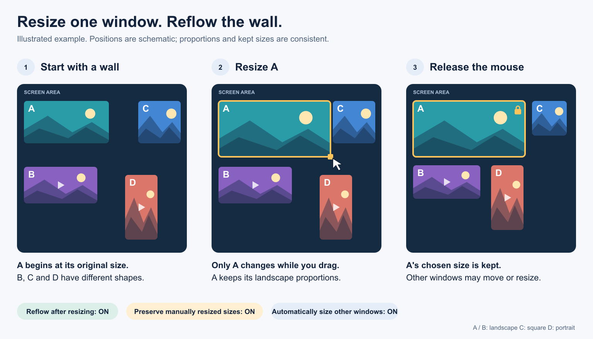
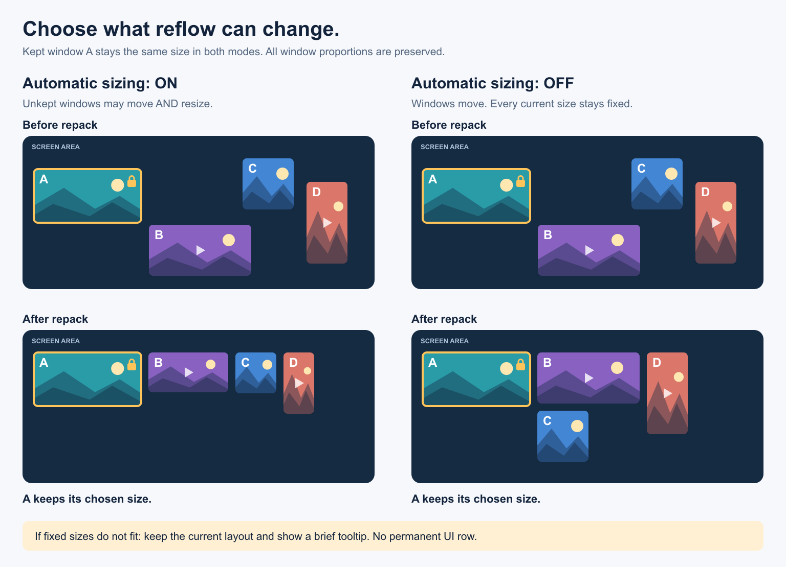
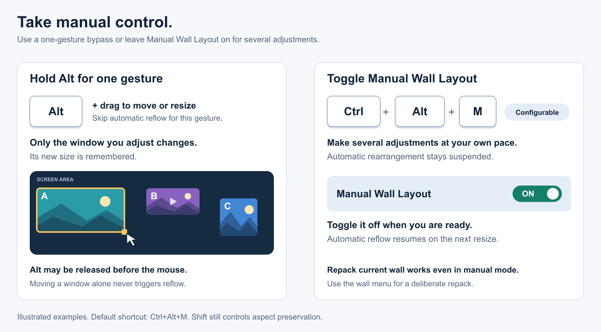

# Masonry Review Wall Guide

[Back to Documentation Hub](HUB.md)

This guide covers the Masonry Wall layout and the review badge workflow.

It is designed for fast comparison of multiple images or videos in separate floating windows, especially when you want to sort many similar generations and mark picks, rejects, questions, or custom badge meanings.

## What It Is

- The Masonry Wall can open the current selection or rearrange the current floating windows as one wall.
- It keeps the top aligned and packs the windows in a masonry-style arrangement across the current screen.
- Mixed images and videos are supported.
- If the wall contains multiple videos, video sync and playback start automatically.
- The wall works together with the review badge system, so you can mark files while comparing them.
- The shared masonry spacing can be adjusted in `Settings -> Advanced -> Floating masonry wall gap (px)`.
- Horizontal alignment can be adjusted in `Settings -> Advanced -> Floating masonry alignment`.
- Right-click a wall window and toggle `Masonry wall controls` live.

  

## Open The Masonry Wall

- Select two or more items in the image list.
- Right-click and choose `Open ... in Masonry Wall`.
- Or press `Ctrl` + `Shift` + `Enter`.
- Or drag a multi-selection from the image list and release it to open the wall directly.

Single-item spawn is still available. The masonry wall is for multi-item review.

## Arrange Existing Floating Windows

- Right-click a floating viewer or comparison window and choose `Arrange as Masonry Wall`.
- This repacks the current floating windows into the same Masonry Wall layout.
- Rearranging starts with the wall controls off.
- Turn them on later from the window right-click menu if needed.

## Why Use It

- Compare many similar generations at once.
- Review short video variants side by side.
- Keep the main window available while using floating viewers for decisions.
- Mark picks and rejects without leaving the comparison workflow.

## Packing and Automatic Reflow

`Settings -> Advanced -> Floating Wall Layout` controls the layout. The same live
options are available under `View -> Wall layout` and by right-clicking a wall
window and opening `Wall layout`.

| Option | Default | Behavior |
| --- | --- | --- |
| Packing algorithm | Best fit | Compare masonry and MaxRects candidates and use the largest feasible window area. |
| Reflow after resizing | On | Repack after the mouse is released. Moving a window alone does not repack. |
| Automatically size other windows | On | Resize windows without kept sizes to fit, preserving their current proportions. Off means positions only. |
| Preserve manually resized sizes | On | Remember each manually resized window's exact size for subsequent repacks. |
| Manual layout shortcut | Ctrl+Alt+M | Suspend automatic rearrangement until toggled again. Configurable in Settings. |

The illustrations below use simplified media windows. They show the behavior of
the controls; their positions are examples rather than exact packing results.

The algorithm can also be set to `Masonry` or `MaxRects`. The right-click menu's
`Packing algorithm (this session)` overrides the saved default without changing
it. Choose `Use settings` to return to the saved algorithm. Changing the session
algorithm repacks the current wall unless Manual Wall Layout is active.

MaxRects packs rectangles without rotating the media. Best fit uses heuristics;
it does not guarantee a mathematically optimal arrangement. Older installations
without `rectpack` fall back to masonry; the normal requirements installation
includes the dependency.

Opening a new wall always chooses initial sizes from the media proportions.
Subsequent repacks use the current window shapes. The existing
`Floating resize keeps aspect ratio by default` setting and Shift override still
control manual resizing. Media itself retains its existing fit/zoom behavior.

For example, resize the first of ten windows and release the mouse: its chosen
size is kept while the others are arranged around it. Resize a second and third
window and their sizes are kept too. The windows may move during a repack.
Use `Keep this window's size` to explicitly keep or release one window's size,
or `Reset kept sizes and fit wall` to release all kept sizes and fit again.
Explicitly kept sizes remain respected even when automatic preservation of
manual resizes is disabled. Size choices last for the lifetime of each window.

*The amber outline marks the window you resize. The lock marks its kept size.*

With automatic sizing off, packing only changes positions. It cannot increase
the windows' combined area. If the sizes do not fit, the current geometry is left
in place and a temporary tooltip explains how to enable sizing or release kept
sizes. The message does not add a status-bar row or reduce the viewer area.

*Automatic sizing applies to windows without kept sizes. Both modes preserve
window proportions; fixed sizes cannot always be made to fit.*

`Preserve screen order when repacking` uses the existing saved rearrange-order
preference. It keeps the current top-to-bottom, left-to-right order, which can
leave less room for packing. Disable it to allow more rearrangement.

## Manual Control

- Hold **Alt** during a resize to skip automatic reflow for that gesture. Releasing
  Alt before the mouse still skips that gesture's reflow. Its new size is remembered.
- Alt-drag also suppresses the floating-window compare-merge gesture.
- Toggle **Manual Wall Layout** with **Ctrl+Alt+M**, or from the Wall layout menu,
  to make several manual adjustments. This also works for walls opened together.
- Resuming automatic layout takes effect on the next resize; it does not immediately
  rearrange the wall. `Repack current wall` explicitly repacks even in manual mode.
- Automatic reflow preserves playback, synchronization, wall controls, and the
  viewer's fit/custom-zoom state. A new gesture, setting change, close, or manual-mode
  toggle cancels an older pending layout result.

Layout calculations for resize reflow run in a worker using only geometry. They
do not reload media or restart the wall. Initial opening and the explicit
`Arrange as Masonry Wall` command retain their synchronous layout calculation.

## Review Badges

Review badges are item-level marks stored separately from normal tags.

They are meant for review workflow state, not caption content. A badge can mean whatever you want it to mean in your workflow.

Current default badge set:

- `1 2 3 4 5`
- `*`
- `!`
- `?`
- `X`

All symbolic badges are stackable. Numeric badges act like a single rank slot.

## Add Badges In The Wall

- Hover a masonry wall viewer to reveal the 3x3 badge slots.
- Click a slot to add or remove that badge from that file.
- After hover leaves, active badges stay visible on that viewer.
- Hover a badge slot to see the generic tooltip.

This makes the wall usable as a direct review surface instead of only a comparison layout.

## Review Toolbar

The detachable `Review toolbar` gives you the same badge actions outside the wall overlay.

- Click badge buttons to add or remove review marks.
- Use `Clear -> Clear Selected` to clear badges from the current review target.
- Use `Clear -> Clear Current Folder` to clear all review badges in the loaded folder.

`Clear Current Folder` shows a confirmation dialog before it runs.

## Badge Settings

`Settings -> Badges` lets you customize the current badge system without changing the number of slots.

You can change:

- badge symbol/label
- optional hover title
- badge color
- shortcut mapping
- text color
- font size
- corner roundness

These settings apply live across:

- the review toolbar
- the masonry wall overlay
- image-list badges

## Keyboard Shortcuts

Default review shortcuts:

- `1` to `5` for numeric rank badges
- `8` or `Shift` + `8` for `*`
- `?` for question
- `X` for reject
- apostrophe/quote key for warning

The exact mappings may differ if you customized them in `Settings -> Badges`.

## Image List Behavior

- Review badges also appear on thumbnails in the image list.
- They persist across reloads because they are saved in the folder DB and JSON sidecars.
- Filtering can use review predicates such as `review:true`, `review:reject`, `review:idea`, and `review_rank:>=2`.

## Related Docs

- [Floating Viewers User Guide](FLOATING_VIEWERS_USER_GUIDE.md)
- [Compare Guide](COMPARE_GUIDE.md)
- [Filtering Guide](FILTERING_GUIDE.md)
- [Shortcuts](SHORTCUTS.md)

The illustrations have editable SVG sources beside their PNG exports in
`images/guides/`. Rebuild them with
`venv/Scripts/python.exe scripts/render_wall_guide_illustrations.py`.
