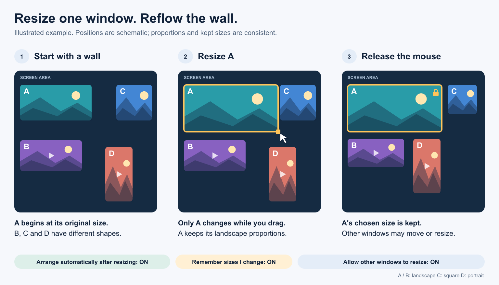
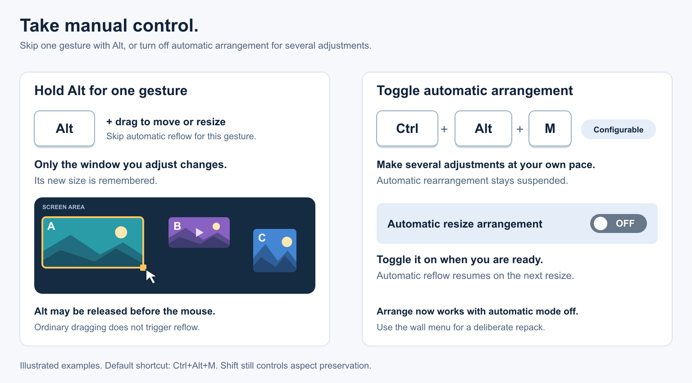
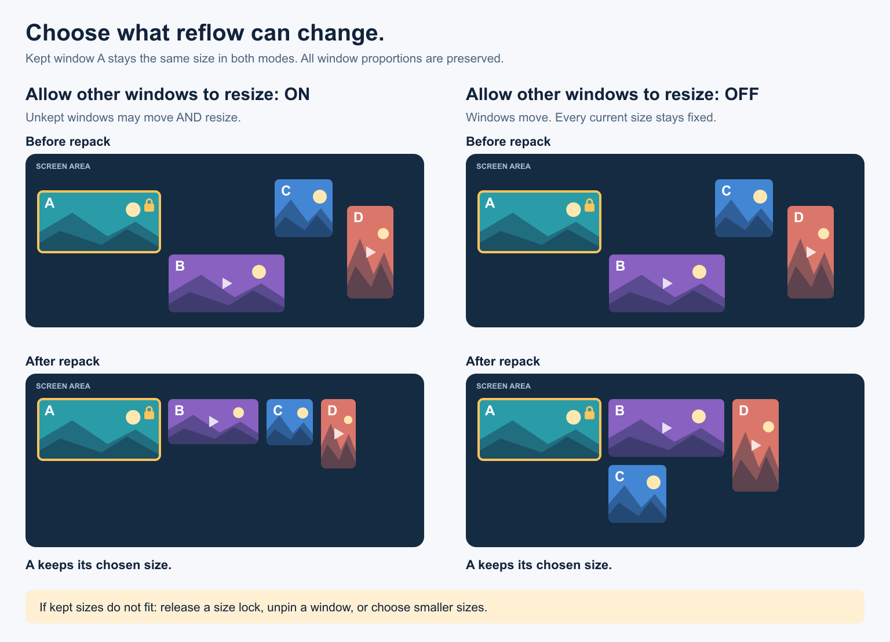

# Masonry Review Wall Guide

[Back to Documentation Hub](HUB.md)

The Masonry Wall arranges selected images and videos in floating windows for
side-by-side comparison. Resize items to emphasize them, pin the ones you want
to keep in place, and use review badges to mark your choices.

## Quick Start

1. Select two or more items in the image list. Press **Ctrl+Shift+Enter** or
   right-click and choose **Open … in Masonry Wall**. Dragging the multi-selection
   onto empty screen space also opens a wall.
2. **Resize a window** from an edge or corner. Ghost outlines preview the layout;
   release the mouse to arrange the other windows. With the default settings,
   your chosen size is remembered.
3. **Ctrl-drag a window** to place it yourself. It snaps to screen edges and
   other pinned windows. Release to pin it and arrange the others around it.
4. **Release a lock** by clicking its small bottom-left icon, or right-click and
   choose **Wall layout → This window → Flexible** to release all of its locks.

To arrange windows you already opened individually, use **View → Arrange as
Masonry Wall**, or **Arrange as Masonry Wall** in a regular floating window's
right-click menu. Review overlays start off for this route; right-click a wall
window and enable **Masonry wall controls** to show them. Opening a selection
starts with these controls on, and multiple wall videos synchronize and play together.

## Window States

Right-click a wall window and choose **Wall layout → This window**:

| State | During arrangement | Use it when… |
| --- | --- | --- |
| **Flexible** | May move and resize, as allowed by wall settings. | You want the wall to fit it automatically. |
| **Keep size** | May move, but retains its dimensions. | You want an item to stay larger or smaller than the others. |
| **Pin in place** | Retains its position and dimensions. | You want to build the layout around its placement. |

A manual resize applies **Keep size** when **Remember sizes I change** is on.
Ctrl-drag applies **Pin in place**. You can still deliberately move or resize a
pinned window; subsequent arrangements respect its new geometry.

Locks last until released or the window closes. The bottom-left **pin** releases
position; the **dotted anchor** releases a kept size. Hover to brighten the icon.
A pinned window shows only the pin; unpinning reveals a separate size lock if one
remains. Choosing **Flexible** clears both.

## Resize and Preview

Drag an edge or corner to resize. The other windows stay still while ghost
outlines show their proposed placements:

- **Amber:** the resized window's proposed destination. It may move on release
  unless pinned.
- **Blue:** the other proposed placements.
- **Red preview:** the current constraints cannot be fitted by the planner.

Release to apply the layout. Windows with kept sizes retain their dimensions;
flexible windows can move and resize around them. Resizing a pinned window also
rearranges the free windows around its new geometry.

Hold **Shift** to preserve proportions while resizing. The setting **Settings →
Advanced → Floating resize keeps aspect ratio by default** reverses this behavior:
proportions are then preserved by default, and Shift allows free resizing.

*Illustrations are schematic. Amber borders and lock symbols highlight the chosen
window; the actual lock controls are small corner icons.*

## Pin and Position

1. Hold **Ctrl**, press the left mouse button on a wall window, and drag.
2. Enlarged red pin icons and matching borders mark the window being placed and
   existing pins. Ghosts preview the remaining layout without moving the other windows.
3. Release to apply the preview and pin the window. Repeat with another window
   to arrange around multiple pins.

During this gesture, **Shift** suppresses magnetic snapping and **Escape** cancels
and restores the starting position. A red preview means the proposed placement
does not fit; releasing restores the dragged window and shows a brief explanation.
The red pin feedback returns to the small translucent icons when the gesture ends.
Ctrl-drag stays on its starting screen and works even with automatic arrangement off.

## Make Manual Adjustments

| Control | Result |
| --- | --- |
| **Middle-drag** | Move a floating window without triggering wall arrangement. |
| **Alt + resize** | Skip automatic arrangement for this gesture. The size is still remembered when that preference is on. |
| **Alt + drag** | Move manually without triggering a comparison merge. |
| **Ctrl+Alt+M** | Toggle automatic resize arrangement on or off. This choice is saved. |
| **Wall layout → Arrange now** | Arrange explicitly, respecting locks, even when automatic arrangement is off. |

Re-enabling automatic arrangement takes effect on the next resize; it does not
immediately move the windows. The toggle shortcut can be changed in **Wall settings**.

## Packing and Automatic Reflow

All layout actions are under **Wall layout** in a wall window's right-click menu.
Wall-wide actions are also available under **View → Wall layout**.

| Entry | Purpose |
| --- | --- |
| **Arrange now** | Fit the current wall, respecting locks. |
| **Arrange automatically after resizing** | Apply the layout when you release a resize. |
| **This window** | Choose Flexible, Keep size, or Pin in place for the clicked window. |
| **Reset layout** | Release locks using the actions below. |
| **Packing algorithm (this session)** | Test an algorithm without changing the saved default. |
| **Wall settings…** | Open the grouped, saved preferences. |

### Reset the Layout

| Action | Releases | Rearranges immediately? |
| --- | --- | --- |
| **Release kept sizes** | Size locks; pins remain. | No |
| **Unpin all windows** | Position pins; separate size locks remain. | No |
| **Start fresh — release all locks and arrange** | All size locks and pins. | Yes |

**Start fresh** also works with automatic arrangement off and leaves that setting
unchanged. Use **Arrange now** after either of the other reset actions when ready.

### Wall Settings

Open **Wall layout → Wall settings…**. The same preferences appear under
**Settings → Advanced → Floating Wall Layout**. Changes apply immediately and are
saved for future sessions.

| Group | Controls |
| --- | --- |
| **Automatic arrangement** | Arrange after resizing; allow other windows to resize; remember sizes you change; toggle shortcut. |
| **Dragging and previews** | Ctrl-drag pinning; magnetic snapping; resize ghosts. |
| **Appearance** | Show or hide the clickable lock icons without changing locks. |
| **Advanced** | Keep the current visual order; choose the default packing algorithm. |

The default is automatic arrangement with resizing, size preservation, snapping,
ghosts, and icons enabled. Turn off **Allow other windows to resize** for
position-only arrangement. Explicit **Keep size** choices remain active even if
**Remember sizes I change** is off.

Spacing and alignment are under **Settings → Advanced → Floating masonry wall gap
(px)** and **Floating masonry alignment**. Keeping the current visual order can
leave less room for packing; disable it to allow more rearrangement.

### Compare Algorithms

Use **Packing algorithm (this session)** to try **Best fit**, **Masonry**, or
**MaxRects**. **Use settings** restores the saved default. Changing the session
algorithm arranges the wall when automatic arrangement is on; otherwise use
**Arrange now**.

**Best fit** compares candidate layouts, **Masonry** arranges windows in columns,
and **MaxRects** fits rectangles without rotating them. Best fit is the default;
none guarantees a mathematically optimal layout. Walls with pins use obstacle-aware
packing, which takes precedence over the algorithm and visual-order preference.

## Review Badges

With **Masonry wall controls** on, hover a window to reveal its 3×3 badge slots.
Click a slot to toggle a mark for that file. Active marks remain visible after
the pointer leaves. Badges are review labels, stored separately from normal tags.

| Default shortcuts | Mark |
| --- | --- |
| **1–5** | Numeric rank; one rank at a time. |
| **8** or **Shift+8** | Star (*) |
| **?** | Question |
| **X** | Reject |
| **Apostrophe/quote** | Warning (!) |

Symbolic badges can be combined. Customize their labels, colors, appearance,
and shortcuts in **Settings → Badges**. Badges also appear on thumbnails and
persist across reloads. Filters include `review:true`, `review:reject`,
`review:idea`, and `review_rank:>=2`.

The detachable **Review toolbar** provides the same actions. **Clear → Clear
Selected** clears the current review target; **Clear → Clear Current Folder**
asks for confirmation before clearing the folder's badges.

For review marks on individual details within an image, use
[stickers](STICKERS_GUIDE.md). Place and edit them in the main viewer; floating
wall viewers display the saved positions. They are separate from the wall's
fixed 3×3 review slots and the thumbnail badges.

Badge shortcuts place stickers when the pointer is over the main image. Move
the pointer away from that image to use the normal badge toggle. Clearing a
badge removes its matching stickers; other sticker types remain.

## Common Questions

**Why didn't the wall rearrange after resizing?**

Check **Arrange automatically after resizing** and whether Alt was used during
the gesture. If fitting failed, try smaller kept sizes, unpinning an item, or
enabling **Allow other windows to resize**. Empty space alone does not guarantee
that the remaining shapes fit within their size and spacing constraints.

**What happens when a layout cannot fit?**

After resizing, your manual change remains and the other windows keep their
positions. An invalid Ctrl-drag restores the dragged window's starting position.
A brief tooltip explains the problem.

**Can a pin extend off-screen?**

Yes. A deliberate resize can extend a pin beyond the screen. The wall preserves
it and uses the remaining visible space for unpinned windows.

**Why can't I draw a hint in a floating window?**

Hint creation belongs to the main viewer. Existing hints remain visible in
floating viewers; Ctrl-drag there is available for wall positioning.

## Related Docs

- [Floating Viewers User Guide](FLOATING_VIEWERS_USER_GUIDE.md): spawning, moving, zooming, and hold mode.
- [Compare Guide](COMPARE_GUIDE.md): comparison and merging.
- [Filtering Guide](FILTERING_GUIDE.md): filtering by review marks.
- [Stickers Guide](STICKERS_GUIDE.md): positioned review badges, hearts, and bombs.
- [Shortcuts](SHORTCUTS.md): other keyboard controls.
