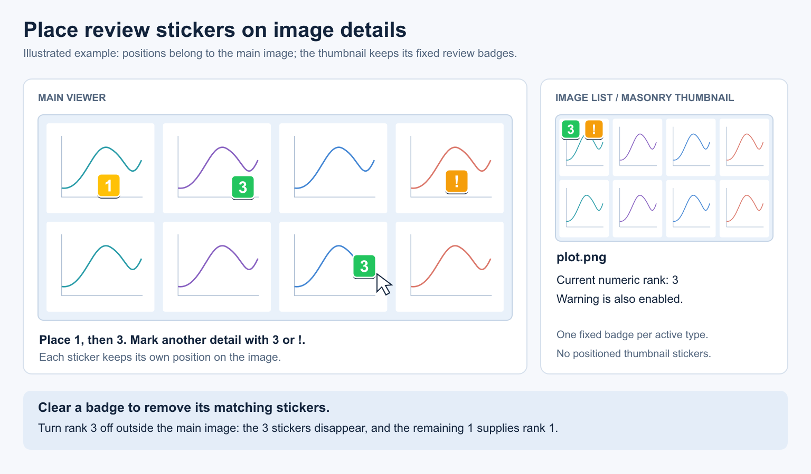

# Stickers Guide

[Back to Documentation Hub](HUB.md)

Stickers place review symbols on specific details in an image. Use them to mark
individual samples in a large plot, flag an area that needs attention, or leave
several review decisions on the same image without drawing bounding boxes.

The main viewer shows each sticker at its chosen position. Thumbnails keep their
usual fixed badges for the image's overall review state.

## Quick Start

1. Open a still image in the main viewer.
2. Move the pointer over the detail you want to mark and press **3**. A rank-3
   sticker appears at the cursor, and the image receives the rank-3 badge.
3. Move to another detail and press another badge shortcut, or **L** for a heart
   and **B** for a bomb. Repeat a shortcut to place more stickers of the same type.
4. Left-drag a sticker to move it. **Alt + left-drag** horizontally on a sticker
   resizes it; right-click it to replace or remove it.

*Illustration is schematic. Sticker positions belong to the image; the thumbnail
badge summarizes its current review state.*

## Place Stickers

### Use a Shortcut Over the Image

Keep the pointer over the image itself in the main viewer, then press a shortcut:

| Default shortcut | Sticker |
| --- | --- |
| **1–5** | Numeric rank |
| **8**, **Shift+8**, or **I** | Star / idea (*) |
| **Shift+1**, **apostrophe**, or **W** | Warning (!) |
| **/** or **Shift+/** | Question (?) |
| **X** | Reject |
| **L** | Love heart |
| **B** | Bomb |

Review badge shortcuts can be customized in **Settings → Badges**. The question
and warning symbol keys depend on your keyboard layout; the alternative keys
above are also available by default.

Over the image, each press adds a sticker, even if that badge or reaction is
already enabled. The shortcut targets the displayed image and uses the cursor's
image position. Black bars around the image, viewer buttons, text fields, and
open menus are not sticker placement areas.

Away from the main image, shortcuts retain their normal review or reaction
actions. Clicking a toolbar button also changes the image-level badge or reaction.
Use a drag, rather than a normal toolbar click, to place a sticker from a button.

### Drag From a Toolbar

- Drag a badge from the **Review toolbar** onto the desired image detail.
- Drag the **Love** or **Bomb** reaction button onto the image for a reaction sticker.

Release over the image to place it. Repeated drops can mark multiple details.

### Choose From the Sticker Menu

Hold **Alt** and right-click a point on the main image, then choose a badge,
heart, or bomb. You can release Alt before choosing the menu entry.

A normal right-click away from a sticker keeps the viewer's usual behavior.
Right-clicking an existing sticker opens its sticker menu without needing Alt.

## Move, Resize, Replace, or Remove

| Control | Result |
| --- | --- |
| **Left-drag a sticker** | Move it to another point on the image. |
| **Alt + left-drag horizontally** | Drag right to enlarge; drag left to shrink. Start on the sticker. |
| **Right-drag horizontally on a sticker** | The same size adjustment with the right mouse button. |
| **Right-click a sticker → another symbol** | Replace its type while retaining its position and size adjustment. |
| **Right-click a sticker → Remove this sticker** | Remove that one placement. |
| **Sticker menu → Clear all stickers** | Remove every sticker from the current image. |
| **Ctrl+Z / Ctrl+Y** | Undo / redo the edit, including sticker removal and clearing. |

**Clear all stickers** is also available in the **Alt + right-click** menu when
the image has stickers. It applies to the current image, not the whole folder.

If another program uses right-drag mouse gestures, use **Alt + left-drag** for
resizing. Alt-dragging elsewhere on the image continues to belong to the normal
marking workflow, so begin the resize gesture on the sticker itself.

## How Stickers Affect Image Badges

Placing a review sticker applies its rank or flag to the image. Placing a heart
enables **Love**; placing a bomb enables **Bomb**. Stickers use this existing
review metadata, so the image can be found through the usual badge and reaction
filters. They do not add text tags.

Several ranks can coexist as stickers, but the image has one current numeric
rank. The most recently placed numeric sticker selects that rank. For example:

1. Place a **1** sticker, then a **3** sticker. Both remain visible; the thumbnail
   shows rank **3**.
2. Move the pointer away from the main image and toggle rank **3** off with its
   shortcut or review button.
3. The **3** stickers are removed. The remaining **1** sticker supplies rank **1**.

Turning off a badge or reaction removes stickers of that type from the affected
image or selected images. Turning off **Love** removes hearts; turning off
**Bomb** removes bombs. Other sticker types remain, and undo restores the removed
stickers together with the image-level state.

Removing an individual numbered sticker through its menu edits that placement;
the image's numeric rank remains until changed through the review controls.
A review flag that was already enabled before its stickers were added can also
remain after those stickers are deleted. Sticker-created flags clear when their
last matching sticker is removed. For hearts and bombs, removing the last sticker
of that type turns off the matching reaction.

## Appearance and Size

Open **Settings → Badges**:

- **Viewer sticker size** changes the base size of viewer stickers.
- **Thumbnail Overlays → Review style** also determines the style of placed
  review badge stickers. The toolbar button's appearance is not the sticker style.
- Review labels, colors, text color, font size, and corner roundness follow the
  badge settings.
- Hearts and bombs use their reaction artwork and render larger than review
  badges at the same base size.

Individual size adjustments are saved relative to the base size. Changing the
base size preserves those adjustments. Stickers retain their screen size while
you zoom; their anchor points move with the image.

## Saving and Viewer Support

Stickers are saved automatically in the image's **`.taggui.json` sidecar**. For
example, `plot.png` uses `plot.taggui.json`. Positions are stored as fractions of
the image width and height, equivalent to percentages, together with the sticker
type and size adjustment. Keep the sidecar with the image when moving your files.

The database stores the image's overall review and reaction state; sticker
positions and individual sizes live in the sidecar. Stickers do not change source
image pixels or define crop, include, or exclude regions. Use the
[Markings Guide](MARKINGS_GUIDE.md) for those workflows.

| View | Sticker support |
| --- | --- |
| **Main viewer, still image** | Place, move, resize, replace, remove, and clear. |
| **Floating viewer / Masonry Wall, still image** | Display saved stickers. Edit them in the main viewer. |
| **Image list / masonry thumbnails** | Keep the normal fixed image-level badges. |
| **Compare mode** | Stickers are hidden until comparison ends. |
| **Video playback** | Positioned stickers are not available. |

Relative positions are useful when an image is resized proportionally. Check
them after cropping, rotating, or replacing the source image with different content.

## Related Docs

- [Masonry Review Wall Guide](MASONRY_REVIEW_WALL_GUIDE.md): fixed review badges and wall controls.
- [Floating Viewers User Guide](FLOATING_VIEWERS_USER_GUIDE.md): viewing the same media in extra windows.
- [Markings Guide](MARKINGS_GUIDE.md): crop areas, hints, and masks.
- [Filtering Guide](FILTERING_GUIDE.md): review, rank, and reaction filters.
- [Shortcuts](SHORTCUTS.md): other keyboard and mouse controls.
